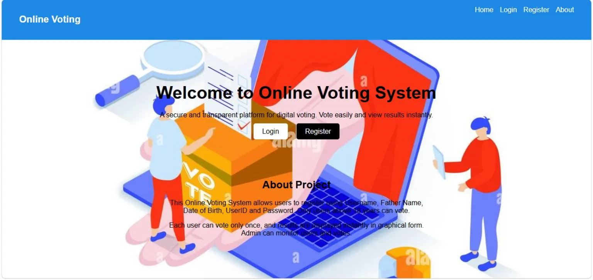
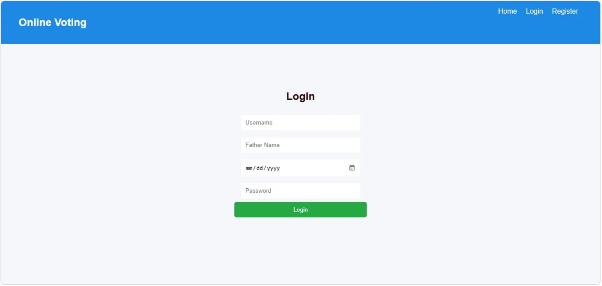
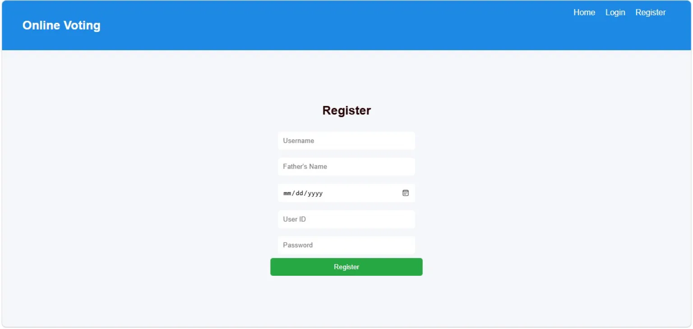
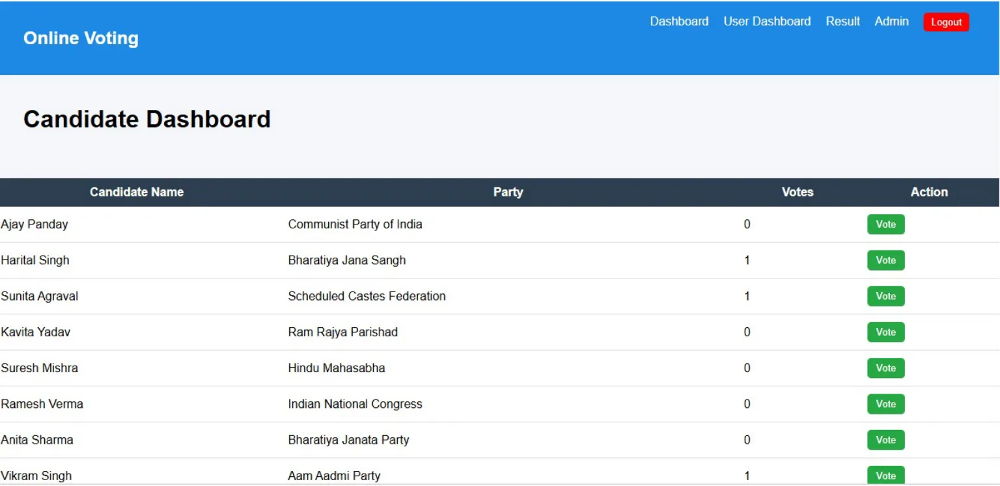
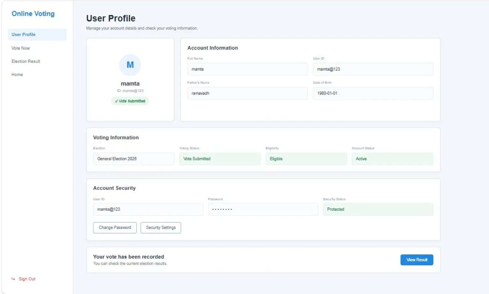
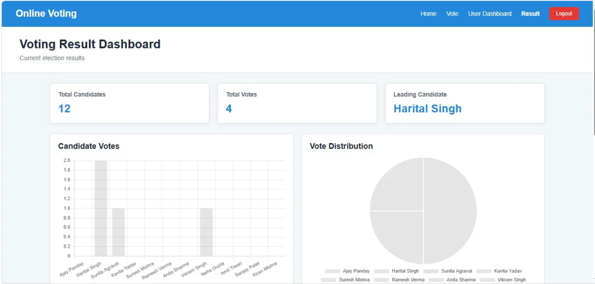
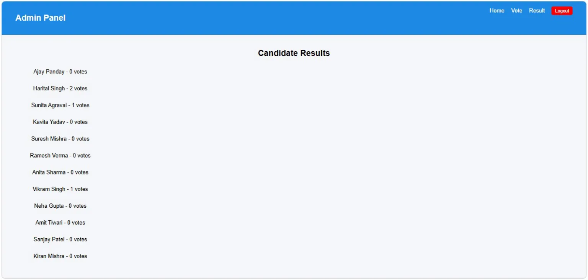

<p align="center">
  
</p>

<h1 align="center">🗳️ Online Voting System</h1>

<p align="center">
  <strong>A secure, transparent and user-friendly digital voting platform.</strong>
</p>

<p align="center">
  
  
  
  
</p>

<p align="center">
  <a href="https://github.com/sangitabind91-web">GitHub Profile</a> •
  <a href="https://www.linkedin.com/in/sangita-bind-100206s">LinkedIn</a>
</p>

---

## 📌 About the Project

The **Online Voting System** is a full-stack web application created to make the voting process easier to access and understand through a digital interface.

Users can register, log in, check their voting eligibility, view candidates, cast a vote and see election results. An administration area provides an overview of candidates and voting results.

This project was developed as an academic project to practise frontend and backend development, database integration, authentication, and data visualization.

## ✨ Features

### 👤 User registration and login
- Register with username, father's name, date of birth, user ID and password.
- Log in using the registered account details.
- JWT-based authentication and protected routes.

### 🎂 Age eligibility
- The application checks the user's age using the date of birth provided during registration.
- Users must be at least 18 years old to be eligible to vote.

### 🗳️ Voting
- View the available candidates and their parties.
- Cast a vote for a preferred candidate.
- The application is designed to allow each user to vote only once.

### 📊 Results dashboard
- View total candidates and total votes.
- See the leading candidate.
- Explore candidate vote counts and graphical vote distribution.

### 🙋 User dashboard
- View profile and account information.
- Check voting status and eligibility.
- Access election results.

### ⚙️ Admin panel
- View candidate-wise vote information.
- Monitor the election results from an administrative view.

### ⚡ Live updates and charts
- Socket.IO is used for real-time communication.
- Chart.js is used to display voting data visually.

## 🧰 Technology Stack

| Technology | Usage |
|---|---|
| React.js | Frontend user interface |
| HTML, CSS, JavaScript | Structure, styling and client-side functionality |
| Node.js | Backend JavaScript runtime |
| Express.js | Backend API framework |
| MongoDB | Database |
| JWT | Authentication and protected routes |
| Socket.IO | Real-time communication |
| Chart.js | Charts and result visualization |
| MongoDB Compass | Database inspection and management |

## 🔄 Application Workflow

```text
        ┌───────────────────┐
        │    Home Page      │
        └─────────┬─────────┘
                  │
          ┌───────▼────────┐
          │ Register / Login│
          └───────┬────────┘
                  │
          ┌───────▼────────┐
          │ Age Eligibility │
          │     Check       │
          └───────┬────────┘
                  │
          ┌───────▼────────┐
          │ Candidate View  │
          └───────┬────────┘
                  │
          ┌───────▼────────┐
          │   Cast Vote     │
          └───────┬────────┘
                  │
          ┌───────▼────────┐
          │ Vote Recorded   │
          └───────┬────────┘
                  │
          ┌───────▼────────┐
          │ View Results    │
          └────────────────┘

          Admin can monitor
          candidates and results.
```

## 📸 Screenshots

The following screenshots show the main interfaces of the application.

### 1. 🏠 Home Page
The landing page introduces the voting platform and provides navigation to login and registration.

<p align="center">
  
</p>

### 2. 🔐 Login Page
Registered users can enter their account details to access the application.

<p align="center">
  
</p>

### 3. 📝 Registration Page
New users can create an account by entering their personal and login details.

<p align="center">
  
</p>

### 4. 🗳️ Candidate Dashboard
Users can see candidate names, party details, vote counts and the voting action.

<p align="center">
  
</p>

### 5. 👤 User Profile Dashboard
The profile area displays account information, voting status, eligibility and account status.

<p align="center">
  
</p>

### 6. 📈 Voting Results Dashboard
The results view presents election statistics and charts for candidate votes and vote distribution.

<p align="center">
  
</p>

### 7. 🛠️ Admin Panel
The admin view displays candidate-wise voting results for monitoring.

<p align="center">
  
</p>

## 🚀 Getting Started

Follow these steps to run the project locally. The commands below are a general setup guide; use the actual frontend/backend folder names and scripts from your repository.

### Prerequisites
- [Node.js](https://nodejs.org/) and npm
- [MongoDB](https://www.mongodb.com/) (local installation or a MongoDB Atlas connection)
- Git

### 1. Clone the repository

Replace the URL with your repository's HTTPS URL.

```bash
git clone https://github.com/YOUR_GITHUB_USERNAME/YOUR_REPOSITORY_NAME.git
cd YOUR_REPOSITORY_NAME
```

### 2. Install dependencies

If your project has separate frontend and backend folders, install dependencies in each folder:

```bash
cd backend
npm install

cd ../frontend
npm install
```

If your repository uses a different folder structure, run `npm install` in the directories that contain the relevant `package.json` files.

### 3. Configure environment variables

Create a `.env` file in the backend directory and add the variable names expected by your backend code. For example:

```env
PORT=5000
MONGO_URI=your_mongodb_connection_string
JWT_SECRET=replace_with_a_private_secret
```

**Important:** These names are examples. Match them to the variables used in your source code. Do not commit real passwords, database credentials or secret keys to GitHub.

### 4. Start the application

Open separate terminals for the backend and frontend, then run the start scripts defined in each folder's `package.json`.

For example, if the scripts are named `start`:

```bash
# In the backend directory
npm start
```

```bash
# In the frontend directory
npm start
```

Open the local frontend address shown in your terminal (commonly `http://localhost:3000` or `http://localhost:5173`, depending on the setup).

## 🎯 Project Objectives

- Make the voting flow easier to use through a web application.
- Provide registration and login functionality.
- Check voter age eligibility.
- Support one vote per registered user.
- Display election results in a clear graphical format.
- Provide an administrative view of candidate results.

## 🧠 What I Learned

Working on this project helped me practise:

- Building a full-stack web application.
- Creating React components and user interfaces.
- Connecting frontend pages with backend APIs.
- Working with MongoDB data.
- Implementing authentication and protected routes.
- Using Socket.IO for real-time communication.
- Presenting data with Chart.js.
- Organizing application features into separate modules.

## 🔮 Possible Future Improvements

- OTP-based account verification.
- More detailed admin controls and audit logs.
- Improved responsive design for mobile devices.
- Stronger security reviews and testing.
- More detailed election analytics.
- Cloud deployment.

## 👩‍💻 Developer

**Sangita Bind**  
B.Tech – Computer Science & Engineering

- GitHub: [sangitabind91-web](https://github.com/sangitabind91-web)
- LinkedIn: [Sangita Bind](https://www.linkedin.com/in/sangita-bind-100206s)

---

<p align="center">
  ⭐ If you find this project interesting, please consider giving the repository a star!
</p>

<p align="center">
  Made with 💙 by <strong>Sangita Bind</strong>
</p>
